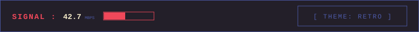
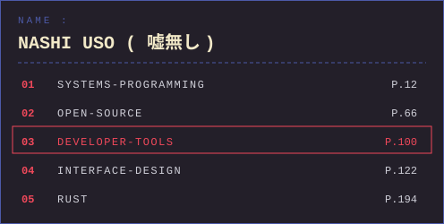
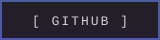
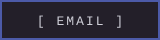
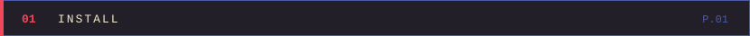
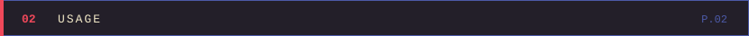
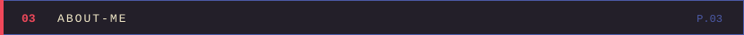

<div align="center">



">

<a href="https://github.com/nashiuso"></a>
<a href="mailto:80126k@proton.me"></a>


</div>

<br>    <br>
<br>    <br>

<div align="center">



</div>

```bash
git clone https://github.com/nashiuso/nashiuso.git
cd nashiuso
pnpm install
```

<br>

<div align="center">



</div>

```bash
pnpm dev        # dev server (Vite)
pnpm build      # production build - dist/
pnpm test       # unit tests (Vitest)
pnpm lint       # lint & format (Biome)
```

<br>

<div align="center">




</div>
